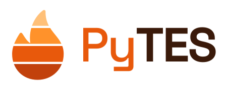

<p align="center">
  <picture>
    <source media="(prefers-color-scheme: dark)" srcset="docs/_static/pytes-logo-dark.svg">
    
  </picture>
</p>

# PyTES

[](https://github.com/mmsg-warwick/PyTES/actions/workflows/tests.yml)
[](https://codecov.io/gh/mmsg-warwick/PyTES)

PyTES (Python Thermal Energy Storage) is a library of models and tools for thermal energy storage (also known as heat batteries), built on
[PyBaMM](https://pybamm.org). What PyBaMM is to electrochemical batteries, PyTES aims to be to thermal
energy storage: a set of validated models that share one interface, so that designs compare
like for like.

PyTES covers storage in which a heat transfer fluid flows through or around a separate
storage medium, such as a phase-change material (PCM) or a sensible solid. Every model is an
ordinary PyBaMM model, so PyBaMM's simulations, solvers and plots work on it directly.

> **Alpha.** The model contract may still change; every change is logged in
> [`docs/design/findings.md`](docs/design/findings.md).

## 📦 Installation

PyTES is not on PyPI yet; install a release from GitHub:

```bash
pip install "pytes @ git+https://github.com/mmsg-warwick/PyTES@v0.1.0a1"          # models and toolkit
pip install "pytes[plot] @ git+https://github.com/mmsg-warwick/PyTES@v0.1.0a1"    # plus the standard plots (matplotlib)
```

PyTES supports every Python version PyBaMM supports (3.10 to 3.15).

## 🚀 Quick start

```python
import pybamm
import pytes

model = pytes.PackedBedModel()  # or pytes.SharpFrontModel(), pytes.MushModel()
solution = pybamm.Simulation(model).solve([0, 3600])
print(solution["Outlet temperature [degC]"].entries[-1])
```

## 🔥 Models

| Family | Models | Storage |
|---|---|---|
| Finned tube | `SharpFrontModel`, `MushModel` | PCM around tubes with metal fins (homogenised or resolved) |
| Packed bed | `PackedBedModel` | a bed of spherical PCM capsules |

Every model takes `options={"storage": "averaged"}` for a faster variant with one storage
cross-section standing for the average along the flow. All models share their outputs
(power, energies, inlet and outlet temperatures, all in SI units with °C, kW and kWh twins),
their experiments, and an exact energy balance, checked by a common conformance suite.

## 🧰 Toolkit

- **Experiments** (`pytes.experiments`): constant inputs or constant power, with
  terminations and cycles.
- **Post-processing** (`pytes.energy_between`) and **standard plots** (`pytes.plotting`).
- **Materials and fluids**, **analytical benchmarks** (`pytes.validation`) and the
  **conformance checks** (`pytes.conformance`), importable for your own PyBaMM models.
- **Composition** (`pytes.ComposedModel`): build a model from PyTES submodels, e.g. to try
  a new heat transfer law.

## 📓 Examples

Notebooks in [`examples/`](examples): the finned-tube and packed-bed models, experiments,
composing models, analytical validation, and a design study comparing the two families.

## 📐 Design

The design decisions, the model contract and the log of changes are in
[`docs/design/`](docs/design).

## 📖 Citing PyTES

If you use PyTES in your work, please cite it: the metadata are in
[`CITATION.cff`](CITATION.cff), and GitHub's "Cite this repository" button gives the
reference in BibTeX or APA. Each release is archived on Zenodo with its own DOI.

## 🤝 Contributing

Contributions are welcome: see [`CONTRIBUTING.md`](CONTRIBUTING.md) for the workflow, the
conventions and how to add a model.

## ⚖️ Licence

BSD 3-Clause, see [`LICENSE`](LICENSE).
